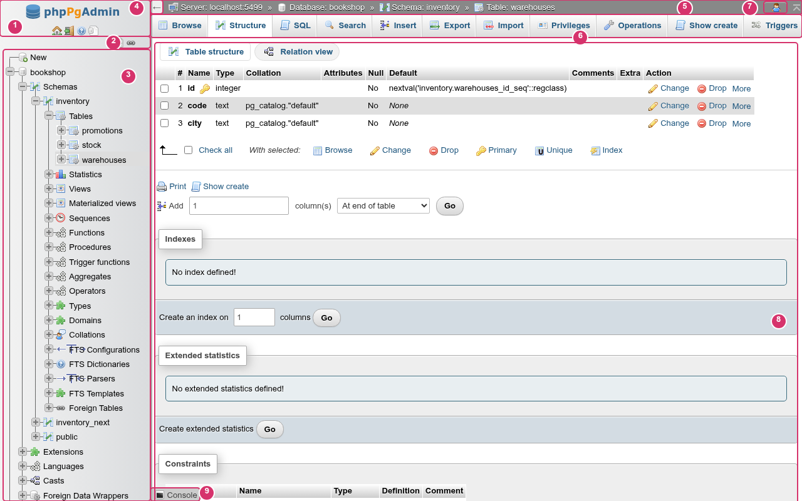

# phpPgAdmin

A web application for administering PostgreSQL 13 and newer. It has the phpMyAdmin interface and covers the PostgreSQL objects and tools that pgAdmin 4 covers.



Documentation: <https://protibimbok.github.io/phpPgAdmin/>

## Features

- phpMyAdmin 5.2 interface: layout, pmahomme theme, tabs, navigation tree, "With selected:" lists
- Databases, schemas, tables, partitions and inheritance
- Views and materialized views
- Functions, procedures, sequences, types, domains and collations
- Indexes, constraints, triggers, rules and row-level security policies
- Full text search configurations, dictionaries, parsers and templates
- Extensions, casts, languages, event triggers, foreign data wrappers and foreign tables
- SQL preview before every create and alter
- SQL editor with autocomplete, formatting, bind parameters, history, bookmarks and macros
- Editable data grid with paging, sorting, filters and inline editing
- Search across every table of a database
- Server status: live charts, sessions with cancel and terminate, locks, prepared transactions
- Server logs, replication slots, standbys, publications and subscriptions
- Roles, memberships, privileges, default privileges and a grant wizard
- Tablespaces and configuration parameters
- Export with `pg_dump` / `pg_dumpall`, CSV import and export through `COPY`
- Import and restore in the background
- Maintenance: `VACUUM`, `ANALYZE`, `REINDEX`, `CLUSTER`
- Designer: an editable ER diagram
- Schema diff with a generated migration script
- PL/pgSQL debugger
- Sign in with a PostgreSQL role; no agent, nothing installed on the database server

## Requirements

- PHP 8.3 or newer with the `pgsql`, `pdo_sqlite`, `mbstring`, `ctype`, `zlib` and `session` extensions; `proc_open` and `exec` not disabled.
- PostgreSQL 13 or newer.
- `pg_dump`, `pg_dumpall`, `pg_restore` and `psql` for export, import and maintenance.

## Installation

### With phnx

[phnx](https://github.com/protibimbok/phnx) sets up local PHP development on Linux and macOS (nginx, PHP-FPM, PostgreSQL) and installs phpPgAdmin as one of its tools.

```sh
curl -fsSL https://raw.githubusercontent.com/protibimbok/phnx/master/scripts/install.sh | bash
phnx configure

phnx setup phppgadmin
phnx php ext install pgsql sqlite3
```

`phnx setup phppgadmin` sets up PostgreSQL if phnx has not yet (with a superuser role `phnx` / `secret`), offers to install the PL/pgSQL debugger, downloads and verifies the latest release into `~/.phnx/tools/phppgadmin`, and serves it at <http://phppgadmin.test>. Run `phnx secure phppgadmin` for HTTPS.

To upgrade, run `phnx setup phppgadmin` again. It keeps `storage/` (saved servers, preferences, history and bookmarks).

### Your own setup

1. Download `phpPgAdmin-X.Y.Z.zip` from [Releases](https://github.com/protibimbok/phpPgAdmin/releases) and unpack it, for example into `/var/www/phppgadmin`. The frontend is already built and `vendor/` is included.
2. Make `storage/` writable by the web server's user.
3. Serve `public/` as the document root with the web server of your choice (nginx with PHP-FPM, Apache, …), sending every path that is not a real file to `public/index.php`. It must be served from the root of a host name, not a sub-path.
4. Open the site and sign in with a PostgreSQL role.

The [installation guide](https://protibimbok.github.io/phpPgAdmin/guide/installation) has example web server configurations, building from source, and the debugger setup.

## License

[MIT](LICENSE)
